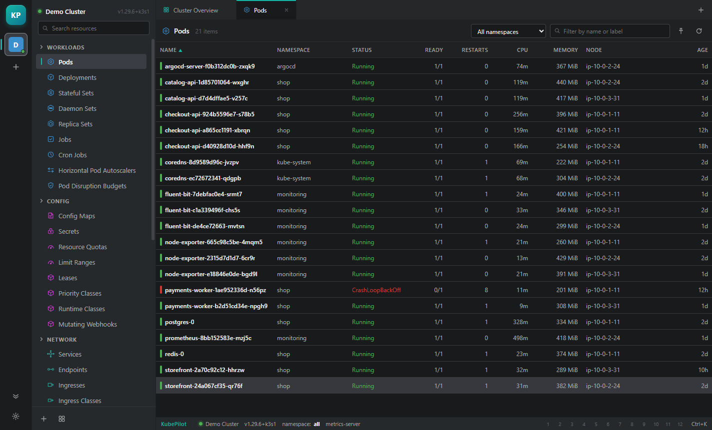
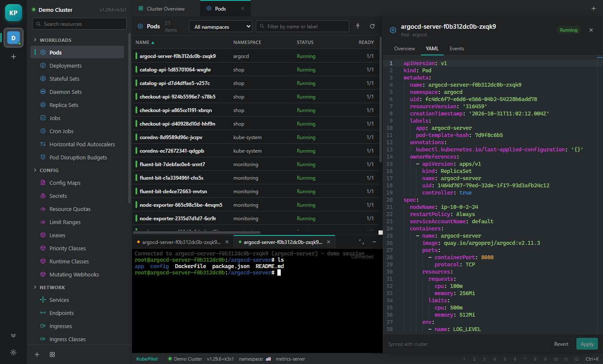
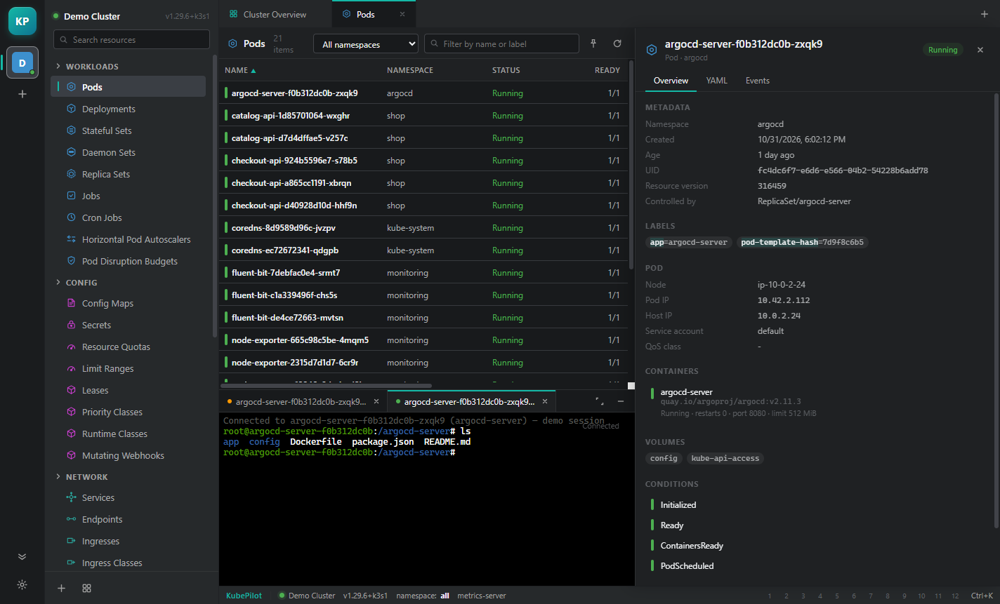
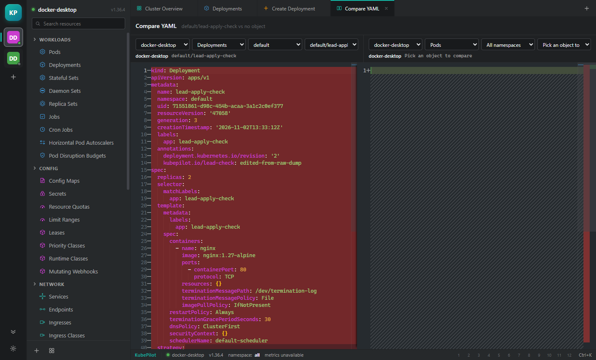

<div align="center">


# KubePilot

**A fast, open-source Kubernetes IDE for the desktop.**

Browse clusters, inspect workloads, edit manifests, diff YAML side-by-side,
stream logs and open a shell — in a native-feeling Electron app with no
telemetry, no account and no vendor lock-in.


[Install](#install) · [Quick start](#quick-start) · [Build installers](#build-installers) · [Architecture](#architecture) · [Contributing](#contributing)

</div>

---

> **Why "KubePilot"?** *Kubernetes* comes from the Greek κυβερνήτης — "helmsman", the
> person who steers the ship. KubePilot is the pilot at the helm of your cluster.

## ✨ Features

| | |
| :--- | :--- |
| 🖥️ **Multi-cluster** | Reads your existing `~/.kube/config` (including `KUBECONFIG`), supports token, client-certificate and `exec` credential plugins with token caching. |
| 📋 **Live resource tables** | Watch-backed lists with sorting, namespace scoping, filtering and per-kind columns. Status colours follow Kubernetes semantics, not just `phase`. |
| 🔍 **Details drawer** | Overview, labels/annotations, containers, conditions and related events for any object. |
| ✏️ **YAML editing** | Monaco editor with server-side apply and `fieldManager`. Server-owned metadata is stripped automatically, so applying an edited manifest never trips over `managedFields`. |
| ⚖️ **Split compare** | A read-only diff editor with two independent cluster → kind → namespace → object selectors — compare two YAMLs inside one cluster or across two different contexts. |
| 📜 **Logs** | Streaming, pause, wrap, clear, multi-container pods. |
| ⌨️ **Terminal** | A real `kubectl exec` shell over WebSocket (`v5.channel.k8s.io`) with resize, and graceful handling of distroless images that have no shell. |
| 🚀 **Apply / scale / restart** | Server-side apply, the `/scale` subresource, rollout restart via the pod-template annotation. |
| 📊 **Metrics** | CPU and memory for pods and nodes from `metrics.k8s.io`, with capacity fallbacks. |
| 🔌 **Port forwarding** | Managed `kubectl port-forward` children with live state. |
| ➕ **Create from templates** | The `+` button offers a YAML scaffold for the resource kind you're looking at — 33 kinds covered. |
| 🎨 **Command palette & themes** | `Ctrl/Cmd + K` palette, hotbar pinning, light and dark themes. |

<p align="center">
  
  
</p>
<p align="center">
  
  
</p>

## Install

### Download

Grab the installer for your platform:

| Platform | File | Notes |
| --- | --- | --- |
| **Windows** x64 | [`release-v11/KubePilot-0.1.0-x64-setup.exe`](release-v11/KubePilot-0.1.0-x64-setup.exe) | Per-user install, no admin rights needed |
| **macOS** | built from source or CI | See [Build installers](#build-installers) — DMG + ZIP for Apple Silicon and Intel |

The macOS disk images are produced by the repository's GitHub Actions workflow
(`.github/workflows/build-mac.yml`) or by running one command on a Mac.

### From source

```bash
git clone <this-repo>
cd lens-desktop
npm install
npm run dev
```

Requires **Node 22** or newer and a kubeconfig (`~/.kube/config` or `KUBECONFIG`).

## Quick start

```bash
npm install
npm run dev        # electron-vite dev server with HMR
npm run build      # compile main, preload and renderer into out/
npm run typecheck  # tsc --noEmit (strict mode)
npm run dist       # Windows NSIS installer
```

Point it at any cluster by adding your kubeconfig in **Settings → Add kubeconfig**.

## Build installers

Two platforms are configured: an NSIS installer for Windows and a DMG plus ZIP for macOS.

### Windows

```bash
npm run dist          # dist/KubePilot-<version>-x64-setup.exe
npm run package       # unpacked build in dist/win-unpacked, no installer
```

The installer is per-user, so it never asks for administrator rights.

### macOS

**This has to run on macOS** — electron-builder drives Apple's `hdiutil`, `codesign`
and `iconutil`, and refuses to start a macOS target on any other host.

```bash
npm run dist:mac        # Apple Silicon + Intel: a DMG and a ZIP for each
npm run dist:mac:arm64  # Apple Silicon only
npm run dist:mac:x64    # Intel only
```

Output lands in `dist/`:

| File | For |
| --- | --- |
| `KubePilot-<version>-arm64.dmg` | Apple Silicon (M-series) |
| `KubePilot-<version>-x64.dmg` | Intel Macs |
| `KubePilot-<version>-<arch>.zip` | The same app, zipped — what auto-update consumes |

Builds are unsigned and unnotarized unless Apple credentials are in the environment.
electron-builder looks for `CSC_LINK` + `CSC_KEY_PASSWORD` (the Developer ID
certificate) and, for notarization, either `APPLE_ID` + `APPLE_APP_SPECIFIC_PASSWORD`
+ `APPLE_TEAM_ID` or the `APPLE_API_KEY*` trio. Nothing has to be changed in the
config to turn either on; with none set, the build still succeeds and macOS Gatekeeper
asks for a right-click → Open on first launch.

`.github/workflows/build-mac.yml` does all of this on a `macos-14` runner for both
architectures and uploads the installers as artifacts, reading the same variables
from repository secrets.

Two helpers keep the macOS side maintainable from any OS:

```bash
npm run icon:icns   # rebuild build/icon.icns from build/icon.png (824/1024 macOS tile margin)
npm run verify:mac  # 26-check validation of the whole macOS packaging config
```

### Pushing this repository

The installer binaries are stored with **Git LFS** (GitHub rejects blobs over 100 MB).
Before your first push:

```bash
git lfs install
git push origin main   # no remote yet? git remote add origin <url>
```

## Keyboard shortcuts

| Shortcut | Action |
| --- | --- |
| `Ctrl/Cmd + K` | Command palette |
| `Ctrl/Cmd + Shift + P` | Command palette (alternative) |
| `Ctrl/Cmd + ,` | Preferences |
| `Ctrl/Cmd + W` | Close active tab |
| `Esc` | Dismiss overlay / close drawer |

## Architecture

```
src/
  main/            Electron main process
    kube/
      config.ts    kubeconfig discovery, parsing, exec credential plugins
      client.ts    native Kubernetes HTTP/WS client (node:https, node:http, ws)
      backend.ts   ClusterBackend interface
      live.ts      LiveBackend — talks to a real API server
      registry.ts  cluster registry + persisted settings
    ipc.ts         every IPC channel, one place
    index.ts       window lifecycle
  preload/         contextBridge surface (window.kube)
  renderer/        React 19 + Zustand UI
  shared/          DTOs shared across all three processes
```

Design notes:

- **No `@kubernetes/client-node`.** It is ESM-only and drags in a large dependency
  tree, so the client is written directly against `node:https`/`node:http`/`ws`.
  This keeps the main bundle small and the watch/reconnect behaviour explicit.
- **Context isolation is on**, `nodeIntegration` is off. The renderer only ever sees
  the typed `window.kube` bridge.
- **Watches are line-buffered NDJSON** with `resourceVersion` tracking, bookmark
  support and exponential backoff, so a dropped connection resumes instead of
  restarting the list.

## Testing

```bash
node tools/e2e-live.mjs <devtools-port>  # 30 checks against a running app + real cluster
npm run verify:mac                       # packaging-config validation
npm run typecheck                        # strict TypeScript
```

## Status

Early but functional. Working today: discovery, lists, watch, details, YAML apply,
delete, scale, restart, split compare, logs, exec, metrics, port forwarding, and
context-aware create templates.

Not yet: Helm, CRD schema validation, RBAC-aware UI, multi-window, Linux packaging
targets.

## Contributing

Issues and pull requests are welcome. For bigger changes, please open an issue first
to discuss what you'd like to change. Run `npm run typecheck` and `npm run build`
before submitting.

## Provenance

KubePilot is an independent, clean-room reimplementation built with JavaScript /
TypeScript and Electron. Its interaction model and visual language were studied from
the publicly distributed Lens desktop application (whose theme package is open
source) in order to build a familiar Kubernetes IDE; no Lens source code is vendored
here, and KubePilot is not affiliated with or endorsed by Mirantis.

## License

[MIT](LICENSE) — contributions welcome.
