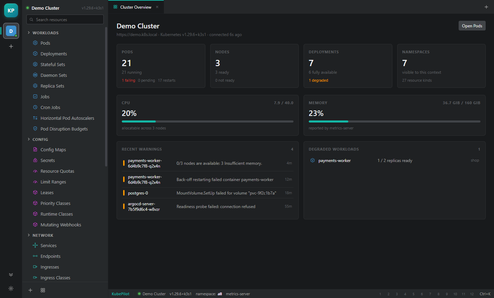

# KubePilot

An open-source Kubernetes IDE for the desktop. Browse clusters, inspect workloads, edit
manifests, stream logs and open a shell — in a fast, native-feeling Electron app with no
telemetry and no account.



> **Why "KubePilot"?** *Kubernetes* comes from the Greek κυβερνήτης — "helmsman", the person
> who steers the ship. KubePilot is the pilot at the helm of your cluster.

## Features

- **Multi-cluster** — reads your existing `~/.kube/config` (including `KUBECONFIG`), supports
  token, client-certificate and `exec` credential plugins with token caching.
- **Live resource tables** — watch-backed lists with sorting, namespace scoping, filtering and
  per-kind columns. Status colours follow Kubernetes semantics, not just `phase`.
- **Details drawer** — overview, labels/annotations, containers, conditions and related events
  for any object, plus a Monaco YAML editor for in-place edits.
- **Logs** — streaming, pause, wrap, clear, multi-container pods.
- **Terminal** — a real `kubectl exec` shell over WebSocket (`v5.channel.k8s.io`), with resize.
- **Apply / scale / restart** — server-side apply with `fieldManager`, `/scale` subresource,
  rollout restart via the pod-template annotation.
- **Metrics** — CPU and memory for pods and nodes from `metrics.k8s.io`, with capacity fallbacks.
- **Port forwarding** — managed `kubectl port-forward` children with live state.
- **Command palette**, hotbar pinning, light and dark themes.
- **Demo cluster** — a fully populated simulated cluster so the UI is explorable with no
  kubeconfig at all.

## Quick start

```bash
npm install
npm run dev        # electron-vite dev server with HMR
npm run build      # compile main, preload and renderer into out/
npm run typecheck  # tsc --noEmit
npm run dist       # Windows NSIS installer in dist/
```

Requires Node 22 or newer. `npm run dist` produces `KubePilot-<version>-x64-setup.exe`.

### Documentation site

A static documentation site and landing page live in `site/`. Preview it locally:

```bash
npm run site        # http://localhost:4173
```

The pages are plain HTML and CSS — no build step. Screenshots are captured from the running app
with `node tools/shots.mjs`, so the docs never drift far from the real UI.

### Keyboard shortcuts

| Shortcut | Action |
| --- | --- |
| `Ctrl/Cmd + K` | Command palette |
| `Ctrl/Cmd + Shift + P` | Command palette (alternative) |
| `Ctrl/Cmd + ,` | Preferences |
| `Ctrl/Cmd + W` | Close active tab |
| `Esc` | Dismiss overlay / close drawer |

## Architecture

```
src/
  main/            Electron main process
    kube/
      config.ts    kubeconfig discovery, parsing, exec credential plugins
      client.ts    native Kubernetes HTTP/WS client (node:https, node:http, ws)
      backend.ts   ClusterBackend interface
      live.ts      LiveBackend — talks to a real API server
      registry.ts  cluster registry + persisted settings
    ipc.ts         every IPC channel, one place
    index.ts       window lifecycle
  preload/         contextBridge surface (window.kube)
  renderer/        React 19 + Zustand UI
  shared/          DTOs shared across all three processes
```

Design notes:

- **No `@kubernetes/client-node`.** It is ESM-only and drags in a large dependency tree, so the
  client is written directly against `node:https`/`node:http`/`ws`. This keeps the main bundle
  small and the watch/reconnect behaviour explicit.
- **Context isolation is on**, `nodeIntegration` is off. The renderer only ever sees the typed
  `window.kube` bridge.
- **Watches are line-buffered NDJSON** with `resourceVersion` tracking, bookmark support and
  exponential backoff, so a dropped connection resumes instead of restarting the list.

## Status

Early but functional. Working today: discovery, lists, watch, details, YAML apply, delete,
scale, restart, logs, exec, metrics, port forwarding, and context-aware create templates.

Not yet: Helm, CRD schema validation, RBAC-aware UI, multi-window, macOS/Linux packaging
targets (the config is Windows-first right now), automated tests.

## Provenance

KubePilot is an independent, clean-room reimplementation built with JavaScript/TypeScript and
Electron. Its interaction model and visual language were studied from the publicly distributed
Lens desktop application (whose theme package is open source) in order to build a familiar
Kubernetes IDE; no Lens source code is vendored here, and KubePilot is not affiliated with or
endorsed by Mirantis.

## License

MIT — see [LICENSE](LICENSE). Contributions welcome.
